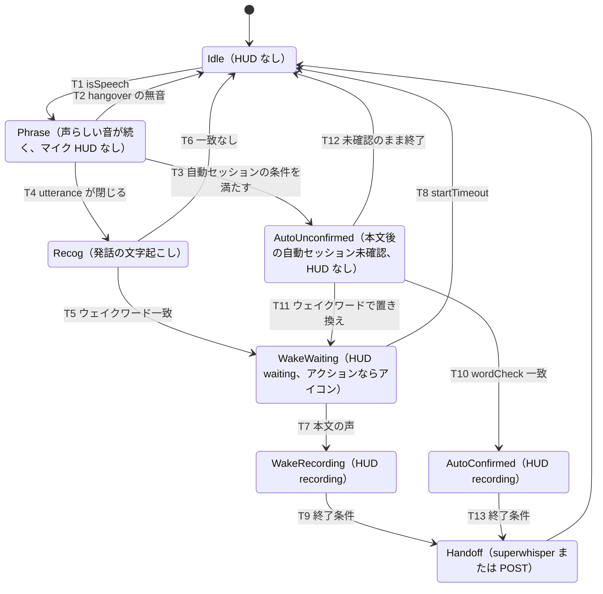
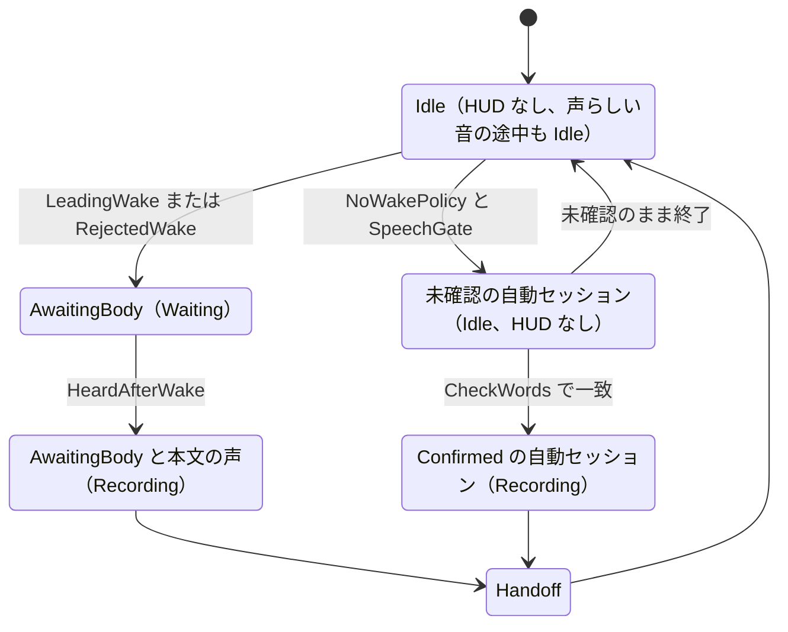

# 音を拾ってから判定までのステートチャート

コード（`cf89a2f` の作業ツリー、A 案を反映・未コミット）から書き起こした。`HudBlip.tla` はこの図を縮めたもので、HUD に関わる部分だけを残している。各遷移のログ文字列は図の下の表にまとめた。

## macOS（`Listener.consume`, Sources/voice-switch/MacApp.swift）

| 遷移 | 条件 | ログ |
|---|---|---|
| T1 | `Segmenter.isSpeech`（rms がしきい値超え、または HAL） | なし。待機中のフレーズだけではマイク HUD を表示しない |
| T2 | `hangoverMs` の無音 | `voice: phrase ... -> shorter than minSpeechMs` / `automatic wake blocked: no voice activity` |
| T3 | `longEnough`、`NoWakePolicy.onSpeech`、`automaticWakeAllowed()`（HAL が 1.5 s 以上、またはその終了後 1.5 s 以内） | `dictation session: automatic`、`-> session opened` |
| T4 | Segmenter が `.utterance` を出す | `dictation recognition: complete` |
| T5 | `wakeWords` か `macOS.actions` に一致 | `dictation started ... -> action X` |
| T8 | `startTimeoutMs` | `dictation cancelled: nothing said after the wake word` |
| T9, T13 | `endSilenceMs`、ストップワード、`maxSeconds` | `dictation ended by ...` / `dictation finished by stop word` |
| T10 | Apple Speech と Whisper が語で一致（1 s ごと） | `dictation session: automatic confirmed by agreed words` |
| T11 | 自動セッション中のウェイクワード | `dictation session: automatic replaced by wake word` |

## Windows（`DictationRuntime`, dotnet/VoiceSwitch.Windows/DictationRuntime.cs）

`relaxedD2` の本文待ちは WakeWaiting に対応させる。本文後でも未確認なら AutoU と同じく表示しない。`heardSpeech` / `stopHeard` は形式モデル外で、本文待ちの停止表示は従来どおり `.stopping` を維持する。`.ended`、`.followup`、配信表示は図から省略している。

## 修正した点滅の 2 つの経路（Mac）

1. Idle で雑音が HAL を鳴らして `phraseHAL > 0` になっても、Phrase では `.idle` のままでマイク HUD は表示しない。追従待機の既存条件を満たす場合の `.followup` は変更していない。
2. 1.5 s 以上話した直後の 1.5 s は `voiceRecentlyActive()` が真なので、雑音で T3 の自動セッションが開くことはある。ただし AutoUnconfirmed は `.idle` のままで、T10 の語の一致確認後にマイク HUD を表示する。確認後の `.recording` / `.stopping` は維持する。

Windows はどちらの場合も Idle のままで、HUD は出ない。ただし `agreedCharacters` が null の構成では、自動セッションがすぐ Confirmed 扱いになる。
