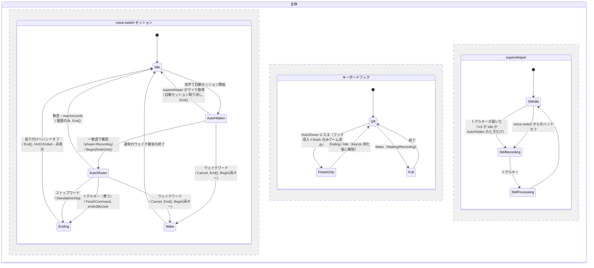

# 自動ウェイク中の superwhisper トグルキーで止める（Mac → Windows 移植）

2026-11-05 時点の main（0f9653c）で読んだ内容。実装はまだしていない。

## 目的

自動ウェイク（`dictation.noWakeWord`）で録音しているときに superwhisper のトグルキーを押すと、Windows ではキーが superwhisper にそのまま届く。そのため superwhisper も録音を始め、二つの録音がずれる。観測されている症状は次のとおり。

1. 自動ウェイク中にトグルキーを押して話し、もう一度押して終えると、superwhisper 側の録音が優先される。
2. voice-switch の HUD が残る。
3. さらにトグルキーを押すと、superwhisper が「トランスクリプションエラー」を出すことがある。

「止める」は人がはっきり意図して行う操作なので、キーでもストップワードでも確実に終えられるようにする。

## Mac の現状（5332dbf, 2026-10-21）

- `Sources/voice-switch/MacApp.swift:1338-1341` は自動セッションを開くときに `Hotkeys.begin(finishOnly: true)` を呼ぶ。奪うのは `KeyboardShortcuts_toggleRecording` だけで、Escape（cancel）は前面アプリに残す（`MacApp.swift:640-647`）。
- 奪ったキーの keyDown と、それに対応する keyUp は superwhisper に届けない（`MacApp.swift:713-729`、`swallowUp`）。
- 次のフレームで `Hotkeys.take() == .finish` になる（`MacApp.swift:1171`, `1244-1256`）。この経路はストップワードの判定待ちも無音待ちも飛ばして、すぐ終える。理由は `"hotkey"`（`FinishCommand`）。`endedByUser = true` で HUD を `.ended` にし、`playStopSound()` を鳴らして `submitAndArm` に渡す。
- 自動セッションの貼り付け: FinishCommand で終えた自動録音は、ストップワードで終えた場合と同じく貼り付けに回す（コミット本文）。
- 未確認の自動セッション（HUD 非表示）でもキーを奪う。CGEventTap は一度入れたら外さず、`active` だけで切り替えるため（`MacApp.swift:692-711`, `723`）。
- ウェイクワードで自動セッションを置き換えるときは、まず `Hotkeys.end()` を呼ぶ（`MacApp.swift:1162`）。その後、通常の開始経路で `begin()` し直す。

## Windows の現状と差分

| 箇所 | 現状 | 差分 |
|---|---|---|
| `dotnet/VoiceSwitch.Windows/DictationRuntime.cs:649-655` | `StartAutomatic` が成功しても `hotkeys?.Begin` を呼ばない。コメントには「No hotkeys: … only silence or a stop word ends it」とある | **ここが欠落箇所**。Mac は 5332dbf でこの方針を変えたが、Windows には移植されていない |
| `dotnet/VoiceSwitch.Windows.Core/DictationHotkeys.cs:97-106` | `Begin` は finish と cancel を必ず両方アームする | finish だけをアームする手段が無い |
| `dotnet/VoiceSwitch.Windows/Tray/KeyboardHook.cs:38-49` | フックが入るのは phase が Waiting か Recording のときだけ | 未確認の自動セッションは phase が Idle（`DictationRuntime.cs:1040`）なので、フック自体が入らない。Mac との違いは下の「決めること」を参照 |
| `DictationRuntime.cs:907-929`（`ApplyHotkey` の Finish） | `session.IsActive` なら `FinishCommand` で終え、`endedByUser = true` にする | 移植済み。そのまま使える |
| `DictationRuntime.cs:1301` | `IsAutomatic && FinishCommand` を貼り付けに回す | 移植済み（5332dbf） |
| `DictationRuntime.cs:401-407`, `410-412`, `443` | ウェイクワードで置き換えると `ResetSession` 内で `End()`。その後は `wasIdle` が真になり、`Begin`（両キー）が呼ばれる | 経路は Mac と同じ形。テストで確かめる |

つまり移植で変えるのは、Core に finish だけのアームを足すことと、ランタイムでそれを呼ぶことの 2 点に絞れる。

## 決めたこと（2026-11-05、案 1 を採用）

**未確認の自動セッション（音声は聞こえているが一致語がまだ無く、HUD が出ていない状態）でトグルキーが押されたとき**

- Mac: キーを奪って終え、貼り付ける。
- 推奨（Windows）: **キーを superwhisper に通す**。HUD が見えていなければ、利用者は superwhisper を起動するつもりでキーを押している。superwhisper がマイクを取れば、`skipWhileMicInUseBy` が voice-switch の自動セッションを取り消す（`NoWakeTests.cs:283` の `dictation cancelled: automatic wake blocked: Superwhisper`）。この場合、二つの録音がずれることはない。
  - この方針なら `KeyboardHook` の条件（Waiting/Recording）を変えずに済む。HUD が出ている間だけキーを奪う、という見た目と挙動が一致する。
  - ただし Mac と挙動が分かれる。Mac 側を揃えるかは別の判断にする。
- アームする時点: Mac と同じくセッションを開いた時点（649）でアームすると、未確認の間もキーを奪うかどうかがフックの入る条件（phase）だけで決まる。そうなると、ランタイムのテストではこの規則を表せない。そこで、ランタイムが**確認済みになった時点**で finish だけをアームする。対象は、開いた時点で確認済みの場合（`agreedCharacters` 無し）と、`CheckWords` で確認された場合の 2 つ。

## 検証項目

Core のテストは `dotnet/VoiceSwitch.Windows.Tests/Program.cs:3268-3291` の形（`DictationHotkeys.OnKey` を直接叩く）を使う。ランタイムのテストは `Program.cs:3310-3327` と `NoWakeTests.cs:253` の形（`hotkeys.OnKey` を注入し、ログ・`Handed`・`Audio.Reason`・`Wake.IsAutomatic` を見る）を使う。

### Core（`DictationHotkeys`）

- **C1** finish だけをアームした状態では、トグルキーの keyDown が `true`（奪う）を返し、`Take()` が `Finish` を返す。
- **C2** finish だけをアームした状態では、Escape（cancel キー）は `false`（通す）を返し、`Take()` は `null` を返す。
- **C3** 奪った keyDown に対応する keyUp も `true` を返す。2 回目の keyUp は `false` を返す（superwhisper に半端な押下を見せない）。
- **C4** `End()` の後は、同じキーを `false` で通す。
- **C5** 既存の両キーアーム（`Begin`）の挙動は変えない（`Program.cs:3268-3291` が通ったままであること）。

### ランタイム（`WindowsDictationRuntime`）

- **R1** 確認済みの自動セッション（phase Recording）でトグルキーを押すと、`dictation ended by hotkey` が記録される。ハンドオフは 1 回で、`Reason == FinishCommand` になる。ログに `automatic ended by FinishCommand, pasting like a wake-word dictation` が出る。
- **R2** R1 の直後、phase は `Ended` になる（`endedByUser`）。その後 Idle に戻り、`hotkeys.End()` が呼ばれている（同じキーをもう一度押すと `false` で通る）。
- **R3** 自動セッション中に Escape を押してもセッションは続き、キーは前面アプリに届く（`false`）。
- **R4** 未確認の自動セッション（phase Idle）では、トグルキーを通す。セッションは終わらず、ハンドオフも起きない（「決めること」で推奨案を採った場合）。
- **R5** 自動セッションが無音・maxSeconds で終わったら `End()` され、以降トグルキーは通る。このときハンドオフは履歴のみで、貼り付けない。
- **R6** 自動セッションをウェイクワードで置き換えたら、新しいセッションは両キーでアームされている（Escape で取り消せる）。
- **R7** セッションが無いときは、トグルキーを通す（現在の挙動を保つ）。
- **R8** 回帰: ウェイクワード・手動・アクションのセッションでは、従来どおり finish と cancel の両方が効く（`Program.cs:2896-2920`, `3310-3459`, `StopWindowTests.cs:44-78`）。
- **R9** 停止音: Mac は hotkey で終えたとき `playStopSound()` を鳴らす（`MacApp.swift:1255`）。Windows で同じ音が鳴るかは未確認。

### 実機（未検証のまま残すもの）

- **M1** Windows 実機: 自動ウェイクで HUD が録音表示のとき、superwhisper のトグルキー（既定 Ctrl+Space）を押す。期待する結果は次のとおり。
  - superwhisper の録音ウィンドウが開かない。
  - voice-switch の HUD が終了表示から消える。
  - 前面アプリに文字が貼り付けられる。
  - もう一度トグルキーを押すと superwhisper が普通に起動し、トランスクリプションエラーが出ない。
- **M2** `verify-voice-switch` は WAV を流すだけで、キー入力は注入できない。`KeyboardHook`（WH_KEYBOARD_LL）は実機で手で押すしか確かめる方法が無い。

### 既存の形式検証への影響

- `verify-hud-blip` のモデル: R4 の推奨案なら、HUD 非表示の状態からキーで抜ける遷移は増えない。確認済みの状態から `Ended` へ抜ける遷移は増えるので、モデルに含まれているか確認する（TLA+ はまだ書かない）。

## ステートチャート（Windows の目標）

3 つの領域が並行して動く。不具合は領域をまたぐ部分で起きている。



不変条件（目標）:

- **I1** VS が `AutoShown` の間、トグルキーの keyDown と keyUp は superwhisper に届かない。そのため SW は `SWRecording` に入らない。
- **I2** VS が `Ending` に入ったら、HUD は Ended を経て必ず消える。ハンドオフは 1 回だけ。
- **I3** VS が `Idle` に戻ったらアームは解除されている。次のトグルキーは superwhisper に届く。
- **I4** Escape は自動セッション中、常に前面アプリに届く。

現状の不具合経路（比較用。I1 が破れる）:

```
VS=AutoShown, KH=Off（Begin していない）
  → トグルキー → SW=SWRecording（VS も録音を続ける）
  → もう一度トグルキー → SW=SWProcessing で superwhisper 側の結果が優先される
  → VS はまだ AutoShown のまま、HUD が残る
  → 3 回目のトグルキー → superwhisper「トランスクリプションエラー」
```
