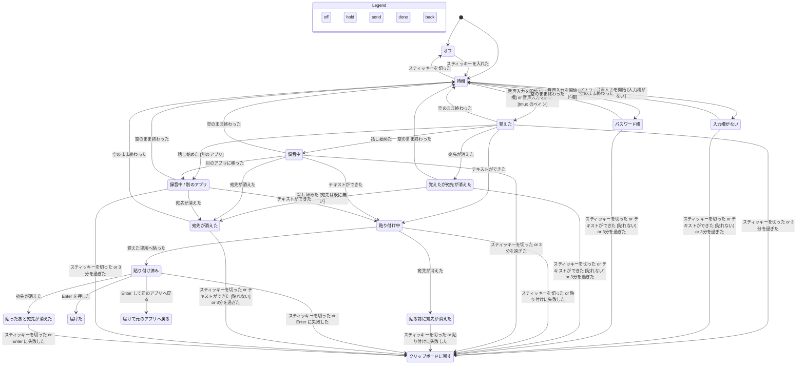

# スティッキーモードの可否（2026-11-20）

プロトタイプは macOS のウェイクワード辞書だけ。フラグ `macOS.stickyTarget` は既定オフ。オフのとき既存の handoff / paste / route は変えない。Windows の貼り戻しは今回は作らない（not possible）。共有 JSON の `macOS` は Windows が無視する。

届けたあとのフォーカス: 配信を始める瞬間に前面だったアプリへ戻す。切り替えていなければ、そのアプリが宛先なのでフォーカスは宛先のまま。復帰に失敗したら宛先に残してログする。tmux は前面を動かさない（ユーザーは今いるアプリのまま。切り替えていればそれが「戻る先」と一致する）。

## 判定

| 問い | 判定 | 根拠 |
|---|---|---|
| 開始時の前面 pid と bundle id | works | 既存の `NSWorkspace.shared.frontmostApplication`。`Dictation.target` が同じ値を既に持っている。 |
| AX の focused element と role / subrole | works | アクセシビリティ許可（`AXIsProcessTrusted`）があるとき。role が `AXTextField` / `AXTextArea` なら field。ブラウザは subrole を欠くことが多いので、subrole の読み失敗だけでは field を捨てない。 |
| ウィンドウ（`kAXWindowAttribute`） | works | 取得はできる。 |
| アプリの再アクティブ | limited | `NSRunningApplication.activate` は既存経路と同じ。前面にならないことがある。 |
| ウィンドウを上げる（`kAXRaiseAction`） | limited | ネイティブは通りやすい。失敗しても、その後の同一要素チェックで止める。 |
| 要素へフォーカス（`kAXFocusedAttribute`） | limited | ネイティブは通りやすい。Chrome / Electron は失敗が多い。戻った要素がキャプチャ時と `CFEqual` で一致しなければ貼らない。 |
| 要素消滅・アプリ終了・ウィンドウ閉鎖 | works | `kAXErrorInvalidUIElement`、`isTerminated`。クリップボードに残し、今の前面には貼らない。 |
| AXValue / `kAXSelectedTextAttribute` で挿入 | not possible | Web、Electron、端末では信頼できない。プロトタイプでは使わない。 |
| ペーストボードと Cmd+V（退避して成功時だけ戻す） | works | ネイティブのテキスト欄。成功したときだけ退避を戻す。 |
| ブラウザ（Chrome / Safari） | limited | フォーカスが同じ要素に戻ったときだけ Cmd+V。戻らなければクリップボードに残す。 |
| Electron（Grok Bot、Slack） | limited | ブラウザと同じ。Enter は送信になることが多い。 |
| iTerm2 + tmux（Claude Code） | works | 開始時の tty を pane id に合わせ、`send-keys -l` の括弧付きペーストのあと Enter。AX よりこちらを優先する。前面にはしない。 |
| tmux なしの iTerm | limited | 端末として activate し、Cmd+V と Enter。括弧付きペーストは端末側の挙動に依存する。 |
| Enter（CGEvent、virtual key `0x24`） | limited | 貼り付けが成功し、宛先がまだ生きているときだけ。IME の変換途中は検出しない。複数行欄では改行になる。Slack や Claude Code では送信になる。 |
| セキュア欄の拒否 | works | 開始時と配信時の両方。subrole `AXSecureTextField` または `IsSecureEventInputEnabled`。 |
| 本文をログに出さない | works | `chars=` の文字数だけ。 |
| 3 分で捨てる | works | 1 tick = 60 秒、`maxAge = 3`。武装中と録音中だけ進む。 |
| オフなら今までどおり | works | セッションは nil。設定キーが無い、または false、かつメニューの上書きが無い。 |
| Windows でも同じ貼り戻し | not possible | 今回の範囲外。設定キーは `macOS` に置き、`DictationConfig` には足さない。 |

## 挿入と Enter

主経路はペーストボード + Cmd+V、または tmux の `send-keys`。AX で値を書かない。

tmux は `ESC [200~`、本文、`ESC [201~` を `-l` で送り、最後に `-l` なしの Enter。括弧が無いと本文の改行が Claude Code の送信になる。`send-keys` が失敗したらクリップボードに残し、前面へ Cmd+V しない。

通常欄は、activate の前に前面アプリを控える。raise、フォーカス、同一要素の確認のあとで Cmd+V。約 80 ms あと、宛先が生きていれば Return。貼ったあと宛先が消えたら Enter は押さない（別アプリに当たる）。

失敗（要素が違う、無効、終了、セキュア、3 分超過、貼り付け失敗）はクリップボードに本文を残す。退避した古いクリップボードは戻さない。理由と文字数をログし、HUD は失敗。今の前面には貼らない。

## 状態遷移

機械は `Idle → Armed → Recording → Delivering → Delivered / FellBack`。図の名前は日本語。モデルは `.claude/skills/verify-sticky-mode/StickyMode.tla`。TLC は 300 distinct states、1138 states generated、depth 9。エラーなし。

図が隠しているもの: 終了後の `Reset`（次の入力を待つ）、3 分に達する前の tick、終了後の ToggleOn、終状態の Done スタッタ。statechart は 598 step を view で隠し、同じラベルの 114 step を矢印に重ねた。終状態からも次の矢印が出る。

色: tan = オフ、blue = 保持、orange = 送信、teal = 完了、yellow = クリップボードへ戻す。
